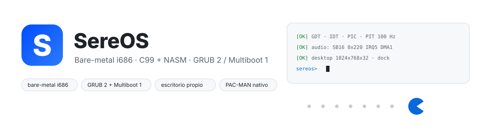

<div align="center">

<picture>
  <source media="(prefers-color-scheme: dark)" srcset="assets/banner/banner-dark.svg">
  <source media="(prefers-color-scheme: light)" srcset="assets/banner/banner-light.svg">
  
</picture>

# SereOS · Sistema Operativo

*Sistema operativo bare-metal para x86 de 32 bits, escrito en C99 y NASM, que arranca con GRUB 2 / Multiboot 1 y no depende de Linux en tiempo de ejecución: kernel propio, gestor de memoria, RAMFS, escritorio gráfico y aplicaciones nativas.*

[](#estado-del-proyecto)
[](#arquitectura)
[](#arquitectura)
[](#pruebas)
[](#pac-man-sereos)
[](LICENSE)

[Descripción](#descripción-general) · [Características](#características) · [Capturas](#capturas) · [Arquitectura](#arquitectura) · [Inicio rápido](#inicio-rápido) · [Pruebas](#pruebas) · [Documentación](#documentación) · [Limitaciones](#limitaciones-conocidas)

[Repositorio](https://github.com/sebas-archive/sereos02) · [Video de presentación](https://youtu.be/g7JM1tLCqa4) · [Informe APA 7](documentacion/ProyectoFinal_sistemas_operativos_APA7.pdf) · [Presentación](documentacion/presentacion/Presentacion_SereOS_Nueva.pptx)

</div>

> [!WARNING]
> **Proyecto académico, no un sistema listo para producción.** SereOS demuestra el arranque, la gestión de hardware y una interfaz gráfica completos, pero la multitarea es **cooperativa**, no existe espacio de usuario ni syscalls, y la paginación es de identidad (sin aislamiento entre aplicaciones). Todo lo que **no** está implementado está documentado sin adornos en [docs/LIMITATIONS.md](sistema%20operativo/docs/LIMITATIONS.md).

## Descripción general

SereOS es el proyecto final de **Sistemas Operativos** de la Universidad Manuela Beltrán (noviembre de 2026). Se compone de dos piezas con **una sola copia de cada lógica**:

| Componente | Ruta | Qué aporta |
|---|---|---|
| **SereOS** | [`sistema operativo/`](sistema%20operativo/) | Kernel bare-metal i686: GDT/IDT propios, PIC/PIT, drivers PS/2 y SB16, memoria, RAMFS, planificador cooperativo, escritorio con ventanas, 4 aplicaciones, shell de 24 comandos y build de la ISO. |
| **PAC-MAN SereOS** | [`Pac-man SereOS/`](Pac-man%20SereOS/) | Videojuego arcade original con núcleo independiente de plataforma y dos backends: SereOS (freestanding, enlazado al kernel) y Linux (SDL2), con suite de 209 verificaciones. |

Un `make` en `sistema operativo/` produce un kernel Multiboot (`sereos.bin`) y una ISO arrancable (`sereos.iso`) que incluye el juego integrado. No hay Linux, ni firmware, ni librería del anfitrión involucrada: el kernel habla directamente con el hardware (y con el hardware emulado por QEMU).

**Video de presentación:** https://youtu.be/g7JM1tLCqa4

## Características

### Núcleo y arranque

| Área | Implementación real |
|---|---|
| Arranque | GRUB 2 + Multiboot 1, menú con dos entradas (escritorio 1024x768x32 y consola VGA de respaldo), modos de vídeo con *fallback* |
| Descriptores | GDT propia de 5 descriptores; IDT con 32 excepciones y 16 IRQ; stubs en NASM |
| Interrupciones | PIC 8259 remapeado a 32–47; PIT a 100 Hz para reloj y temporización |
| Entrada | Teclado PS/2 (IRQ 1, set 1, US) y ratón PS/2 (IRQ 12) con cursor absoluto |
| Diagnóstico | Log del kernel (`dmesg`) por COM1 y VGA; pantallas de excepción y pánico seguras |
| Tiempo | RTC CMOS (comandos `date` y `time`) |

### Memoria, almacenamiento y tareas

- **Heap estático de 8 MiB** con asignador *first-fit*; paginación de identidad.
- **RAMFS** en memoria con directorios, archivos, permisos básicos y operaciones `ls`, `cat`, `write`, `mkdir`, `touch`, `rm`.
- **Planificador cooperativo** (round-robin, hasta 32 tareas) con cambio de contexto por pasos cortos: sin multitarea preemptiva.
- **libc freestanding** propia (strings, formato, conversión) — sin `glibc`.

### Interfaz gráfica

- **Escritorio propio estilo macOS**: splash, barra superior de 30 px, dock de 58 px, ventanas con semáforo, arrastre, redimensión y maximización *full-bleed*.
- **Sistema de diseño único** (paleta carbón, escala 4/8, radios 4–18 px, contraste 16,3:1) documentado en [docs/DESIGN.md](sistema%20operativo/docs/DESIGN.md).
- **Tipografía** Inter + JetBrains Mono rasterizada a atlases en tiempo de compilación (cobertura ASCII + Latin-1, sin dependencias en ejecución).
- **Logotipo oficial** con componente de dibujo aislado (`gui/logo.c`); 36 iconos lineales generados por script.
- Resoluciones verificadas: **1024x768** (principal), **1280x1024** y **800x600**.

### Aplicaciones y shell

| Aplicación | Función |
|---|---|
| **Terminal** | Shell con 24 comandos: `help`, `ls`, `cd`, `cat`, `write`, `mkdir`, `touch`, `rm`, `mem`, `free`, `sysinfo`, `dmesg`, `date`, `time`, `audio`, `beep`, `audiotest`, `about`, `version`, `ticks`, `scroll`, `clear`, `pwd`, `echo` |
| **Gestor de archivos** | Navegación del RAMFS, creación y borrado |
| **Monitor del sistema** | Memoria, tareas, ticks, uptime y audio en vivo |
| **Acerca de** | Versión, hardware detectado y backend de audio activo |
| **PAC-MAN SereOS** | Juego completo embebido, con audio SB16 y menús arcade |

### Audio

- **Sound Blaster 16** real: DSP, DMA 8237, PCM 8 bits mono, **IRQ 5** y detección del *mixer*.
- *Fallback* al **altavoz del PC** por el canal 2 del PIT cuando no hay tarjeta.
- Contrato no bloqueante (`audio_play`, `audio_loop`, `audio_update`) y diagnóstico por `audio`, `beep` y `audiotest`.
- Configuración de QEMU y VirtualBox documentada en [docs/AUDIO_VM.md](sistema%20operativo/docs/AUDIO_VM.md).

### PAC-MAN SereOS

- **Core independiente de plataforma** (`src/core`) + render compartido (`src/render`) + dos backends (`src/platform/sereos`, `src/platform/linux`).
- **Una sola lógica, dos salidas**: biblioteca freestanding `libpacman.a` para el kernel y binario SDL2 para CachyOS/Linux.
- **209 checks** de core y **7/7 pantallas smoke** (attract, menú, ajustes, juego, pausa, game over, victoria) en `make test`.
- Recursos arcade de `Res` con atribución y aviso de no redistribución; arte propio como *fallback*; fuente Press Start K.
- Detalle completo en [`Pac-man SereOS/README.md`](Pac-man%20SereOS/README.md).

## Capturas

<div align="center">

| Escritorio | Terminal |
|:---:|:---:|
|  |  |
| **Gestor de archivos** | **Monitor del sistema** |
|  |  |
| **PAC-MAN SereOS** | **Multiventana** |
|  |  |

</div>

Hay 42 capturas del suite completo en [`sistema operativo/docs/screenshots/`](sistema%20operativo/docs/screenshots/), incluida la comparativa antes/después del rediseño.

## Arquitectura

### Flujo de arranque

```
GRUB 2 (Multiboot 1)
   └─ boot/boot.s            pila, validación Multiboot, salto a C
       └─ kernel_main()      GDT → IDT → PIC → PIT → teclado/ratón → audio
           ├─ memoria        heap 8 MiB first-fit + paginación identidad
           ├─ filesystem     RAMFS inicial (/, /home, /docs...)
           ├─ drivers        PS/2, RTC, SB16/DMA, VGA
           └─ gui/desktop    bucle del escritorio + scheduler cooperativo
```

### Módulos del kernel

| Directorio | Responsabilidad |
|---|---|
| `boot/` | Entrada Multiboot, stubs de interrupción, linker script |
| `kernel/` | `kernel_main`, GDT, IDT, PIC, PIT, pánico |
| `memory/` | Heap first-fit, `memcpy`/`memset` y paginación |
| `drivers/` | Teclado y ratón PS/2, RTC, serie COM1 |
| `filesystem/` | RAMFS y VFS mínima |
| `process/` | Tareas cooperativas y planificador |
| `graphics/` | Framebuffer, compatibilidad VGA de texto, atlases de fuente |
| `gui/` | Escritorio, ventanas, widgets, iconos y logotipo |
| `apps/` | Terminal, gestor de archivos, monitor y «Acerca de» |
| `audio/` | SB16 + DMA 8237 + PC speaker |
| `shell/` | Shell compartida y sus 24 comandos |
| `libc/` | Implementación freestanding de C estándar |

### Estructura del repositorio

```
sereos02/
├── sistema operativo/     kernel, drivers, memoria, RAMFS, GUI, apps, shell, docs
├── Pac-man SereOS/        juego: core + render + plataformas SereOS/Linux + tests
├── documentacion/         informe APA 7, presentación, diagramas, video y capturas
├── Entregas tareas/       auditorías QA, evidencias y reportes de verificación
└── assets/banner/         banners del README (claro/oscuro)
```

## Inicio rápido

### Requisitos (Arch Linux / CachyOS)

```bash
sudo pacman -S --needed base-devel nasm grub xorriso mtools qemu-system-x86
```

Con `gcc -m32` multilib es suficiente; si tienes el compilador cruzado `i686-elf-gcc` en el `PATH`, el Makefile lo prefiere automáticamente.

### Compilar y arrancar SereOS

```bash
cd "sistema operativo"
make                 # compila libpacman.a + kernel + sereos.iso
make run             # QEMU con ventana
make run-headless    # QEMU sin ventana, log en serial.log
```

La ISO también se puede grabar en un USB y arrancar en hardware real BIOS (el audio SB16 depende del equipo).

### Compilar y probar PAC-MAN SereOS por separado

```bash
cd "Pac-man SereOS"
make linux           # binario SDL2: build/pacman-sereos
make sereos          # librería freestanding: build/sereos/libpacman.a
make test            # 209 checks de core + 7/7 pantallas smoke
```

## Pruebas

### Suite de verificación en QEMU

La suite automatizada arranca la ISO real en QEMU y valida el sistema por marcadores en COM1 y capturas de pantalla.

```bash
cd "sistema operativo"
make
python3 tools/run_tests.py            # 18 casos
python3 tools/run_tests.py --list     # ver los casos
python3 tools/run_tests.py --only boot,terminal,game
```

| Resultado | Valor |
|---|---|
| Casos | **18 / 18 correctos** |
| Capturas generadas | 42 |
| Entorno | QEMU 11.1.3, KVM activo, 256 MiB |
| Última ejecución | 2026-11-20 · `docs/screenshots/test-results.json` |

Casos cubiertos: `boot`, `terminal`, `files`, `monitor`, `about`, `game`, `audio`, `maximize`, `corners`, `dock`, `topnav`, `window_close`, `window_focus`, `text_fallback`, `panic`, `resolution_1280`, `resolution_800`, `no_fatal`.

### Pruebas del juego

`make test` en `Pac-man SereOS/` ejecuta el harness de core con plataforma simulada más el smoke SDL2 sin ventana (`SDL_VIDEODRIVER=dummy`).

## Documentación

| Documento | Contenido |
|---|---|
| [Informe final APA 7](documentacion/ProyectoFinal_sistemas_operativos_APA7.pdf) | Documento técnico completo (112 páginas) |
| [Presentación](documentacion/presentacion/Presentacion_SereOS_Nueva.pptx) | 21 diapositivas de exposición |
| [docs/FEATURES.md](sistema%20operativo/docs/FEATURES.md) | Lista honesta de lo implementado y cómo se verificó |
| [docs/LIMITATIONS.md](sistema%20operativo/docs/LIMITATIONS.md) | Lo que no está implementado y por qué |
| [docs/BUILD.md](sistema%20operativo/docs/BUILD.md) | Compilación paso a paso, compilador cruzado incluido |
| [docs/RUN.md](sistema%20operativo/docs/RUN.md) | Arranque en QEMU, audio y grabación WAV |
| [docs/DESIGN.md](sistema%20operativo/docs/DESIGN.md) | Sistema de diseño: tokens, tipografía, métricas |
| [docs/AUDIO_VM.md](sistema%20operativo/docs/AUDIO_VM.md) | Audio en QEMU y VirtualBox |
| [docs/PAKMAN_SEREOS.md](sistema%20operativo/docs/PAKMAN_SEREOS.md) | Integración del juego en el kernel |
| [CHANGELOG](sistema%20operativo/CHANGELOG.md) | Historial de versiones 0.1 → 1.9 |
| [THIRD_PARTY_NOTICES](THIRD_PARTY_NOTICES.md) | Avisos de terceros: recursos arcade, fuentes y alcance exacto del MIT |

## Estado del proyecto

| Aspecto | Estado |
|---|---|
| Kernel bare-metal i686 | ✅ GDT, IDT, PIC, PIT, excepciones, pánico |
| Memoria y RAMFS | ✅ Heap 8 MiB, first-fit, RAMFS con operaciones de archivo |
| Escritorio y ventanas | ✅ Dock, topbar, maximización, resize, 3 resoluciones |
| Aplicaciones | ✅ Terminal, archivos, monitor, acerca de |
| Audio | ✅ SB16 real + IRQ 5, fallback a PC speaker |
| PAC-MAN integrado | ✅ Jugable con audio, menús y pausa |
| Suite QEMU | ✅ 18/18 |
| Multitarea preemptiva / espacio de usuario | ❌ Fuera del alcance (ver [limitaciones](sistema%20operativo/docs/LIMITATIONS.md)) |

## Limitaciones conocidas

- Multitarea **cooperativa**, sin prioridades ni aislamiento temporal.
- **Sin espacio de usuario ni syscalls**: kernel y apps comparten anillo 0 y espacio de direcciones.
- **Sin protección de memoria** entre aplicaciones ni *fault isolation*.
- **Sin SMP, ACPI ni APIC**; interrupciones legacy y apagado por QEMU.
- **Sin FPU/SIMD**: matemática en punto fijo (Q8.8 en el juego).
- Audio SB16 depende del hardware/emulador; VirtualBox usa AC'97 por defecto.

## Créditos y licencia

Proyecto académico de **Sistemas Operativos** — Universidad Manuela Beltrán, noviembre de 2026.

El **código original** de SereOS y PAC-MAN SereOS se distribuye bajo **licencia MIT**: puedes usarlo, copiarlo, modificarlo y redistribuirlo citando el aviso de copyright de [LICENSE](LICENSE).

- Código, kernel, GUI y documentación: equipo del proyecto.
- Tipografías **Inter** y **JetBrains Mono**: SIL Open Font License 1.1 (se usan en tiempo de compilación, no se redistribuyen como archivos).
- Recursos arcade de PAC-MAN (`Pac-man SereOS/assets/`): propiedad de sus autores, incluidos con atribución; **no** están cubiertos por el MIT y no se autoriza su redistribución pública.
- El alcance exacto de cada licencia y de los contenidos de terceros está en [THIRD_PARTY_NOTICES.md](THIRD_PARTY_NOTICES.md).

<div align="center">

**[⬆ Volver arriba](#sereos--sistema-operativo)**

</div>
