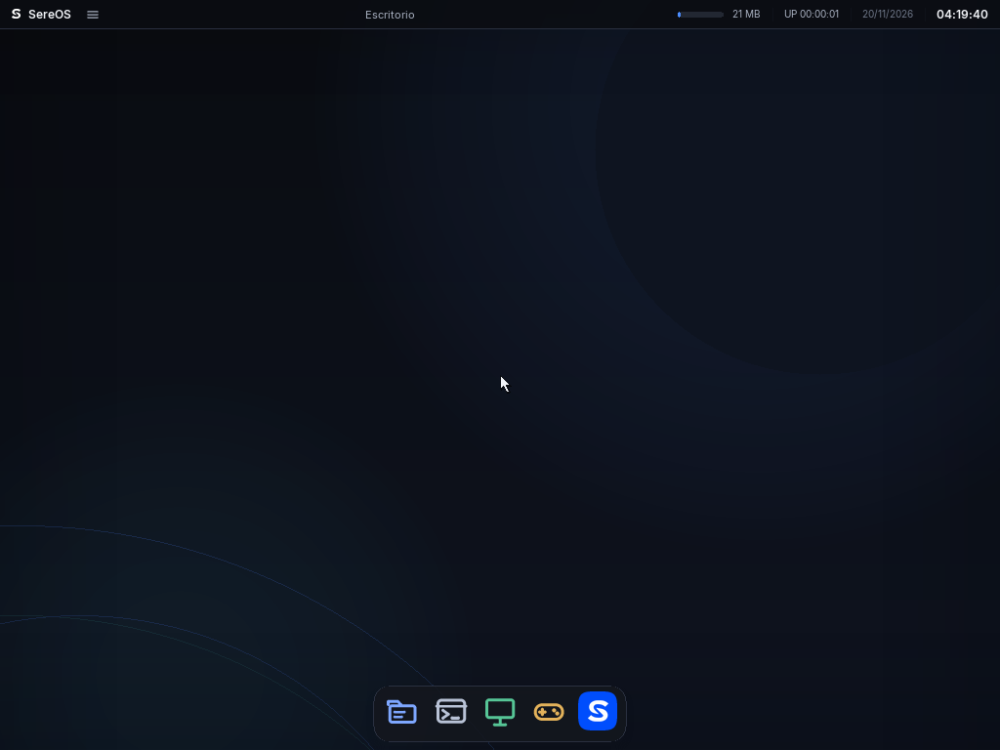

# SereOS v1.0 «SereOS Desktop»

SereOS es un **sistema operativo propio bare-metal** para x86 de 32 bits
(i686), escrito en C99 y NASM, que arranca con GRUB 2 / Multiboot 1 y no usa
Linux ni ninguna librería del sistema anfitrión. Incluye un **escritorio
gráfico estilo macOS** (ventanas, dock, barra superior, cursor), aplicaciones
nativas y el componente de juego **PAC-MAN SereOS** (enlazado como librería
freestanding).



## Identidad visual

SereOS v1.0 incluye un rediseño visual integral con un **sistema de diseño
único** para escritorio, ventanas, las 4 apps, splash y pantalla de pánico:

* **Paleta carbón** (`#0B0D12` de fondo, superficies `#14171E`/`#1A1E26`,
  bordes `#2A3040`, azul de acento `#4C8DFF`, cian `#4CC9E0`) con texto de
  alto contraste (`#F2F4F8` sobre superficie = **16,3:1**).
* **Tipografía** Inter (UI) y JetBrains Mono (terminal/datos), ambas **SIL
  Open Font License 1.1**, rasterizadas en tiempo de compilación a atlases de
  cobertura alfa (sin dependencias en ejecución; cobertura ASCII + Latin-1).
* **Escala 4/8**, radios 4–18 px, sombras sutiles y **iconografía lineal
  original** de 36 ids generada por `tools/gen_ui_icons.py`.
* **Composición de ventanas**: esquinas redondeadas de radio 10 px con
  clipping real (el contenido llega hasta el arco y el fondo/sombra exterior se
  conserva, sin parches cuadrados); las maximizadas son full-bleed sin radios.
* **Logotipo oficial** (S blanca sobre azul, `assets/logo/official_logo.png`,
  1296x1213) usado en splash, menú, About y pantalla de pánico; se escala
  siempre por altura conservando la proporción (nunca se deforma). La barra
  superior usa el PNG **ribbon** (`assets/logo/ribbon_s_logo.png`) sin fondo, a
  la altura del wordmark. Ver [docs/LOGO.md](docs/LOGO.md).
* Splash minimalista de ~1 s, barra superior de 30 px y dock centrado de 58 px.
* **Barra de tareas adaptativa**: al maximizar una ventana, el dock flotante se
  convierte en una barra full-width de 48 px con iconos centrados, app activa
  resaltada y tray (memoria/reloj) a la derecha; la ventana ocupa el work area
  real entre la topbar y la barra. Al restaurar/minimizar/cerrar la última
  maximizada vuelve el dock.
* **Maximización full-bleed**: la ventana maximizada cubre exactamente
  `x=0..sw-1, y=30..sh-49` (sin radios, sombras, márgenes ni wallpaper; barras
  globales una sola vez). Semáforo verde o **doble clic en la barra de título**
  maximizan/restauran; restaurar recupera el rect exacto; minimizar conserva el
  estado maximizado; las apps adaptan su contenido. Las ventanas normales se
  pueden **redimensionar** por bordes/esquinas (mínimo 300x180).
* Resoluciones verificadas: **1024x768** (principal), **1280x1024** y
  **800x600**.

Detalle completo del sistema de diseño (tokens, tipografía, métricas,
contraste, comparativa antes/después) en [docs/DESIGN.md](docs/DESIGN.md).
Comparativa visual: [docs/screenshots/compare_before_after.png](docs/screenshots/compare_before_after.png).

## Componentes y proyecto final

El proyecto final se organiza en dos componentes con **una sola copia** de cada
lógica:

* **`sistema operativo/`** (esta carpeta): kernel, drivers, memoria, RAMFS,
  escritorio y aplicaciones nativas, más el registro de apps. `make` genera
  `sereos.bin` y `sereos.iso`.
* **`../Pac-man SereOS/`** (carpeta hermana): videojuego **PAC-MAN SereOS**
  (versión definitiva M2/M3/M4) con lógica y render compartidos y dos backends
  —SereOS nativo (freestanding) y Linux (SDL2)—. El OS **no contiene copia del
  juego**: `make` construye `../Pac-man SereOS/build/sereos/libpacman.a`
  (target `game-lib`) y la enlaza al kernel después de los objetos y antes de
  `-lgcc`. `apps/apps.c` solo llama a `app_game()`. Detalle, auditorías y
  licencias de los recursos en [docs/PAKMAN_SEREOS.md](docs/PAKMAN_SEREOS.md).

## Requisitos (Arch Linux / CachyOS)

```bash
sudo pacman -S --needed base-devel nasm grub xorriso mtools qemu-system-x86
```

* `gcc` del sistema compilando en `-m32 -ffreestanding` (necesita multilib:
  `lib32-gcc-libs`), **o** el compilador cruzado `i686-elf-gcc` (AUR), que el
  Makefile detecta automáticamente.
* Detalle de dependencias y solución de problemas en
  [docs/BUILD.md](docs/BUILD.md).

## Compilar y ejecutar

```bash
make                # compila el OS + libpacman.a y genera sereos.iso
make game-lib       # recompila el componente ../Pac-man SereOS/ (libreria)
make run            # QEMU con ventana (KVM si /dev/kvm es escribible)
make run-audio      # QEMU con SB16 y audio audible (backend del anfitrión)
make run-audio-wav  # QEMU headless con SB16 grabando a audio-capture.wav
make run-headless   # QEMU sin ventana (CI); log de arranque en serial.log
make clean
```

`make` construye primero la librería del componente de juego (`game-lib`) y
después enlaza el kernel; `GAME_DIR` permite apuntar a otra ubicación del
componente: `make GAME_DIR="/ruta/PAC-MAN SereOS"`.

Al arrancar aparece el menú de GRUB durante 2 s con dos entradas:

1. **SereOS 1.0 - SereOS Desktop**: escritorio gráfico 1024x768x32.
2. **SereOS 1.0 - modo texto (diagnóstico)**: consola VGA 80x25 con shell.

Los mensajes del kernel salen por COM1 y quedan en `serial.log`. Guía completa
de ejecución, atajos y monitor de QEMU en [docs/RUN.md](docs/RUN.md).

## Pruebas automatizadas

Con la ISO compilada:

```bash
python3 tools/run_tests.py            # suite completa en QEMU + capturas PNG
python3 tools/run_tests.py --list
python3 tools/run_tests.py --only boot,game,audio
python3 tools/run_tests.py --kvm off
```

La suite arranca QEMU headless, espera los marcadores del puerto serie, pulsa
teclas por el monitor de QEMU, captura la pantalla con `screendump`, convierte
los PPM a PNG sin dependencias externas y analiza que las imágenes no estén en
negro. También comprueba el audio con una captura WAV del SB16 (peak/RMS) y que
no haya `SEREOS_EXCEPTION`/`SEREOS_PANIC`. Salidas:

* `docs/screenshots/*.png` — capturas finales (splash, escritorio, terminal,
  explorador, monitor, «Acerca de», PAC-MAN SereOS, multiventana, VGA texto…).
* `docs/screenshots/test-results.json` — resumen detallado de la ejecución.
* `docs/screenshots/raw/<fecha>/` — PPM y `serial.log` crudos (se limpian con
  `make clean`; no se entregan).

## Funcionalidades

* **Kernel**: GDT/IP/IDT propias, PIC 8259, PIT 100 Hz, teclado y ratón PS/2,
  RTC CMOS, PC speaker, SB16, consola VGA y framebuffer lineal 1024x768x32.
* **Memoria**: allocator de marcos de 4 KiB, paginación de identidad con PSE
  (4 MiB), heap `kmalloc/kfree` de 8 MiB.
* **RAMFS**: sistema de archivos en memoria real (árbol de nodos), usado por la
  shell y el explorador.
* **Tareas**: planificador cooperativo round-robin con tareas dormidas.
* **Gráficos**: backbuffer, presentación por regiones sucias, clipping, alfa,
  degradados, sombras, sprites RGB565 y **motor tipográfico** con Inter
  (UI) y JetBrains Mono (datos) rasterizados a atlases alfa (Latin-1),
  además de la fuente bitmap 8x16 de compatibilidad.
* **Escritorio**: splash animado con log real del kernel, barra superior con
  reloj y logotipo oficial, dock flotante; con una ventana maximizada el dock
  desaparece y los 5 accesos pasan a la topbar central (navegación adaptativa),
  ventanas con semáforos, cursor compuesto y atajos de teclado.
* **Aplicaciones**: Terminal (shell con scrollback), Archivos (RAMFS),
  Monitor (memoria/heap/ticks/tareas), Acerca de y **PAC-MAN SereOS**.
* **PAC-MAN SereOS**: juego original de laberinto con Pacman, 4 fantasmas con
  IA, dots, power pills, frutas, vidas, récord, efectos de sonido SB16 y
  sprites/audio originales generados en el repositorio. Ver
  [docs/PAKMAN_SEREOS.md](docs/PAKMAN_SEREOS.md).
* **Shell** compartida entre terminal gráfica y consola VGA: `help`, `ls`,
  `cd`, `pwd`, `mkdir`, `touch`, `cat`, `write`, `rm`, `dmesg`, `date`,
  `free`, `mem`, `ticks`, `about`, `echo`, `scroll`, `div0`, `sysinfo`,
  `version`, `clear`, `time`.
* **Audio**: Sound Blaster 16 (DSP + DMA, PCM 8 bits mono) con fallback al
  altavoz del PC; efectos originales sintetizados en el repo. Verificado con
  `make run-audio-wav` y la prueba `audio` de la suite (WAV no silencioso).
* **QA**: arnés de QEMU, conversión/análisis de capturas y suite de
  verificación (ver arriba).

## Controles

| Contexto | Tecla | Acción |
|---|---|---|
| Escritorio | F1 / F2 / F3 | Archivos / Terminal / Monitor |
| Escritorio | F4 / F5 | PAC-MAN SereOS / Acerca de |
| Escritorio | F6 / F7 | Siguiente ventana / Minimizar |
| Escritorio | Ctrl+W o Alt+W | Cerrar ventana activa |
| Pacman | Flechas o WASD | Mover a Pacman |
| Pacman | Enter | Iniciar / confirmar |
| Pacman | Esc | Pausa; volver desde el menú |
| Pacman | R | Reiniciar partida |
| Pacman | Q | Volver al título desde la pausa; Esc en el título sale al escritorio |

## Estructura del proyecto

```
boot/        arranque Multiboot e ISR (NASM)
kernel/      GDT, IDT, main, log, pánico
drivers/     serial, teclado/ratón PS/2, PIT, RTC, speaker, SB16, VGA
audio/       capa de audio y efectos originales (SFX)
memory/      marcos, paginación PSE y heap
process/     tareas cooperativas y planificador
filesystem/  RAMFS
graphics/    framebuffer, primitivas y fuente
gui/         escritorio: compositor, ventanas, dock, iconos, splash, cursor
apps/        terminal, archivos, monitor, acerca de y registro de apps
shell/       intérprete de comandos compartido
libc/        cadena/memoria básicas
tools/       arnés de pruebas QEMU, PPM→PNG y utilidades
docs/        documentación y capturas finales
```

Componente externo (hermano de esta carpeta):

```
../Pac-man SereOS/   juego original: core/render compartidos y backends
                     SereOS (freestanding) y Linux (SDL2). El OS enlaza
                     ../Pac-man SereOS/build/sereos/libpacman.a (app_game)
```

## Estado de verificación

La suite `tools/run_tests.py` se ejecuta sobre la ISO real en QEMU i386 con KVM:

La ISO final v1.8 integra **PAC-MAN SereOS v3** (attract/PRESS START, menús
arcade, audio Game Start corregido, respawn de fantasmas entre tiles y muerte
que conserva laberinto/puntuación/nivel) como librería (`make clean && make`,
**cero warnings**; `sereos.bin` de 1.250.856 B e ISO de 36.282.368 B). El
componente aprobado es `pacman-sereos` md5 `42f33373…` y `libpacman.a` md5
`28a84127…` (**131/131 + 7/7 tests**). La prueba `game` se re-verificó sobre
esta ISO (attract → menú → `GAME_START` → muerte real conservando stats →
pausa → `GAME_EXIT`, 0 excepciones); la pasada oficial completa la ejecuta QA
sobre este build:

| Prueba | Resultado | Qué comprueba |
|---|---|---|
| `boot` | **PASS** | `SEREOS_BOOT_OK`, `SPLASH_DONE`, `DESKTOP_READY`, `GUI_READY` y capturas de splash/escritorio |
| `terminal` | **PASS** | F2 abre la terminal; `help`, `ls`, `date`, `free` y `dmesg` producen salida visible |
| `files` | **PASS** | F1 abre el explorador del RAMFS y navega de `/` a `/home` |
| `monitor` | **PASS** | F3 abre el monitor con datos reales del kernel |
| `about` | **PASS** | F5 abre «Acerca de»: **14/14** componentes y backend de audio |
| `maximize` | **PASS** | full-bleed full-height x=0..w-1, y=30..sh-1 sin wallpaper ni barra inferior; restaurar rect exacto; doble clic; minimizar conserva maximizado; resize (898→946 px, mínimo 300) y apps adaptadas |
| `corners` | **PASS** | esquinas redondeadas sin parches: dentro del arco barra de estado (26,30,38), fuera fondo (10,13,24), 0 px de cuerpo fuera; también con solape y resize (900→940 px) |
| `dock` | **PASS** | dock flotante visible sin maximizadas y de vuelta al cerrar la ventana; topbar sin nav |
| `topnav` | **PASS** | con maximizada: 0 dock/barra inferior, app hasta y=sh-1, 5 accesos centrados (448..575), 1 activo; multicuenta, minimizar última → dock, transición sin duplicados, clics 5 accesos sin APP_OPEN duplicado, 800/1280 |
| `game` | **PASS** | PAC-MAN SereOS definitivo (`libpacman.a`): attract/PRESS START, menú arcade, `GAME_START`, dots, power pill, `GAME_PAUSE`, `GAME_OVER`, `GAME_EXIT` con escritorio recuperado |
| `audio` | **PASS** | QEMU + SB16 graba `audio-capture.wav`: **9,02 s**, 44,1 kHz, peak **23.296** (71% FS), RMS **18.237** → no silencioso |
| `window_close` | **PASS** | cierre de las 4 ventanas (Ctrl+W) y escritorio limpio |
| `window_focus` | **PASS** | F6 cambia el foco y F7 minimiza |
| `text_fallback` | **PASS** | 2ª entrada de GRUB → `SEREOS_TEXT_MODE` y shell VGA |
| `panic` | **PASS** | `div0` real desde la terminal → `SEREOS_EXCEPTION` y captura de pánico sobria (`15_panic`) |
| `resolution_1280` | **PASS** | ISO temporal con framebuffer real **1280x1024** y app abierta (sin tocar el repo) |
| `resolution_800` | **PASS** | ISO temporal con framebuffer real **800x600** y app abierta |
| `no_fatal` | **PASS** | **0** `SEREOS_EXCEPTION` / `SEREOS_PANIC` inesperados (la excepción de `panic` es intencionada) |

**Total: 18/18 PASS, 0 FAIL, 0 SKIP** · **41 capturas PNG** + comparativa en
[`docs/screenshots/`](docs/screenshots/) · `KVM=si` · QEMU 11.1.3 · resumen
completo en
[`test-results.json`](docs/screenshots/test-results.json).

Capturas finales: `00_grub_menu`, `01_splash`, `02_desktop`, `02b_topbar_dock`,
`02c_dock_tooltip` (tooltip «PAC-MAN SereOS»),
`03_terminal`, `04_files`, `04b_files_home`, `05_monitor`, `06_about`,
`07_pacman_titulo`, `08_pacman_ready`, `08b_pacman_partida`,
`09_pacman_comiendo`, `10_pacman_frightened`, `11_pacman_pausa`,
`12_pacman_gameover`, `13_multiventana`, `14_text_mode`, `15_panic`,
`16_resolution_1280x1024`, `17_resolution_800x600`, `18_dock_window`,
`21_dock_restored`,
`22_menu_logo`, `25_maximized_fullbleed`, `26_restore_exact`,
`27_doubleclick`, `28_minimize_restore`, `29_max_terminal`, `30_resize`,
`31_max_1280`, `32_max_800`, `33_window_corners_clean` (mosaico 10x),
`34_topnav_maximized`, `35_topnav_active`, `36_topnav_restore_dock`,
`37_topnav_multiwindow`, `38_topnav_minimize_last`, `39_topnav_800` y
`40_topnav_1280`; comparativa
[`compare_before_after.png`](docs/screenshots/compare_before_after.png) y set
previo al rediseño en [`screenshots/before/`](docs/screenshots/before/).

Resultados completos y capturas: [docs/screenshots/](docs/screenshots/) y
[docs/screenshots/test-results.json](docs/screenshots/test-results.json).

## Limitaciones conocidas

Modelo cooperativo sin multitarea preemptiva, sin espacio de usuario ni
syscalls, sin red, sin USB ni disco persistente, sin FPU/SIMD, sin SMP, RAMFS
volátil y límites fijos (8 ventanas, 32 tareas, 64 nodos, 1 KiB por archivo),
audio PCM 8 bits mono, y juego de un solo laberinto. Lista completa y honesta
en [docs/LIMITATIONS.md](docs/LIMITATIONS.md).

## Créditos y atribuciones

* Proyecto final de **Sistemas Operativos — UMB 2026**.
* **PAC-MAN SereOS** es el videojuego arcade del proyecto, con lógica y render
  propios. La versión definitiva usa **recursos privados de `Res`** (frutas,
  cuerpos de fantasmas recoloreados, fuente arcade Press Start K y PCM de sus
  WAV) con **atribución y sin redistribución pública**; el arte propio del
  componente queda como *fallback*. Ver
  [assets/LICENSE_RES.md](../Pac-man SereOS/assets/LICENSE_RES.md) y
  [docs/PAKMAN_SEREOS.md](docs/PAKMAN_SEREOS.md).
* **Paku-Paku** (VB6) se usó únicamente como **referencia técnica** de lógica
  de juego (auditoría del componente en
  [AUDIT_PAKUPAKU.md](../Pac-man SereOS/docs/AUDIT_PAKUPAKU.md) y recursos en
  [AUDIT_RESOURCES.md](../Pac-man SereOS/docs/AUDIT_RESOURCES.md)); su código
  no se redistribuye. La documentación del juego está en
  [docs/PAKMAN_SEREOS.md](docs/PAKMAN_SEREOS.md).
* GRUB 2 y QEMU pertenecen a sus respectivos proyectos y se usan como
  cargador y emulador de desarrollo.
* Documentación: [docs/BUILD.md](docs/BUILD.md), [docs/RUN.md](docs/RUN.md),
  [docs/FEATURES.md](docs/FEATURES.md), [docs/LIMITATIONS.md](docs/LIMITATIONS.md),
  [docs/PAKMAN_SEREOS.md](docs/PAKMAN_SEREOS.md), [docs/AUDIO.md](docs/AUDIO.md),
  [docs/LOGO.md](docs/LOGO.md),
  [docs/PAKU_AUDIT.md](docs/PAKU_AUDIT.md), [CHANGELOG.md](CHANGELOG.md) y las
  referencias del juego en [docs/reference/](docs/reference/).
